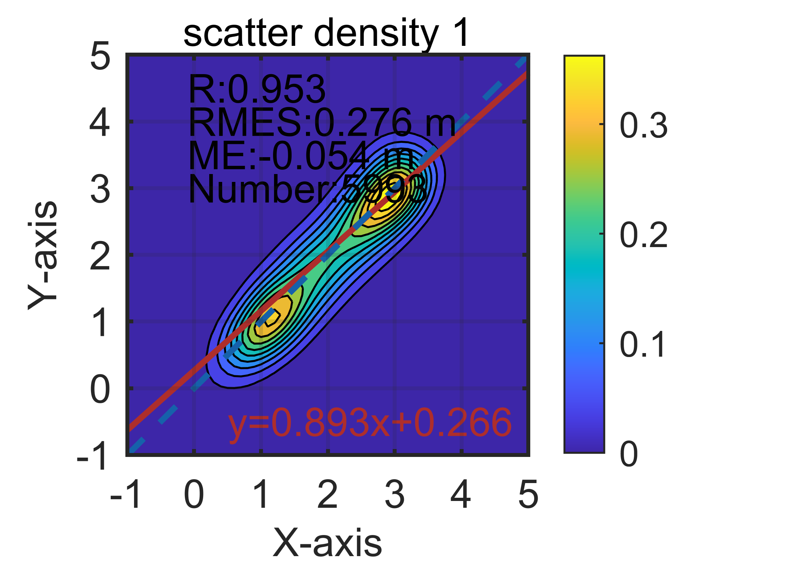
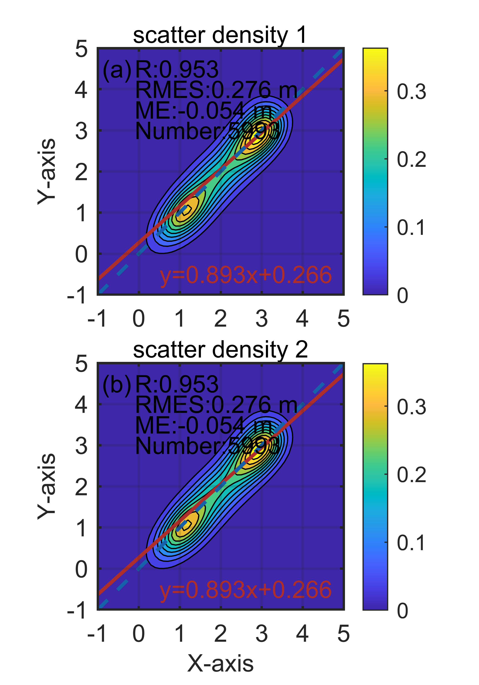
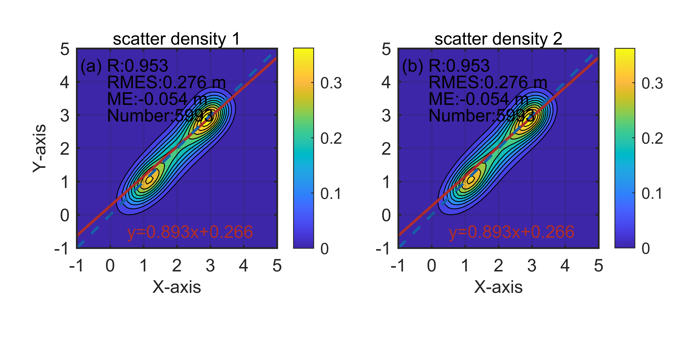
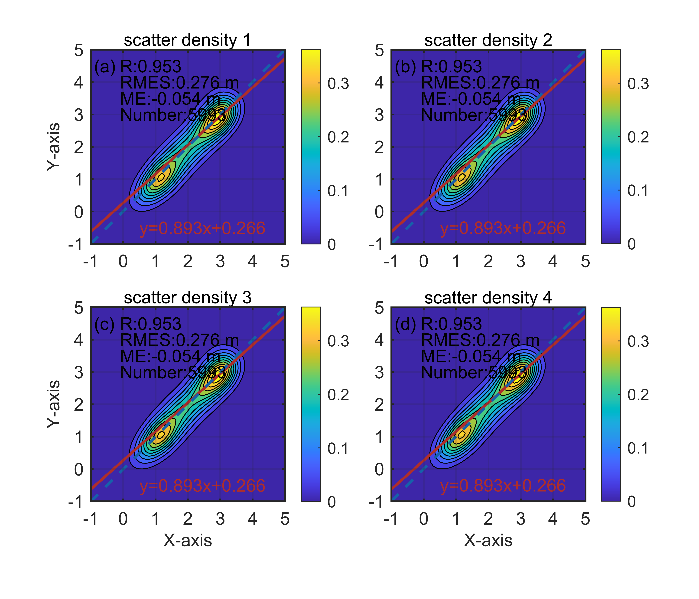
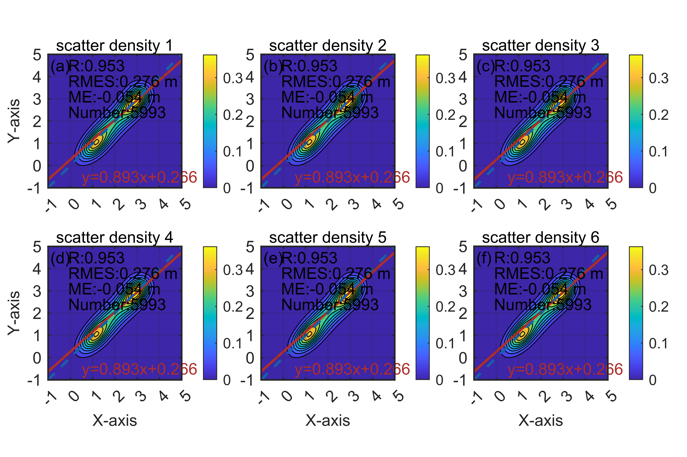
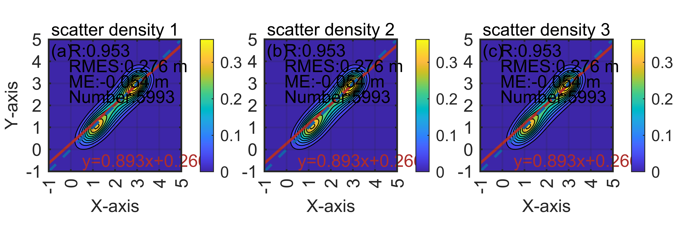
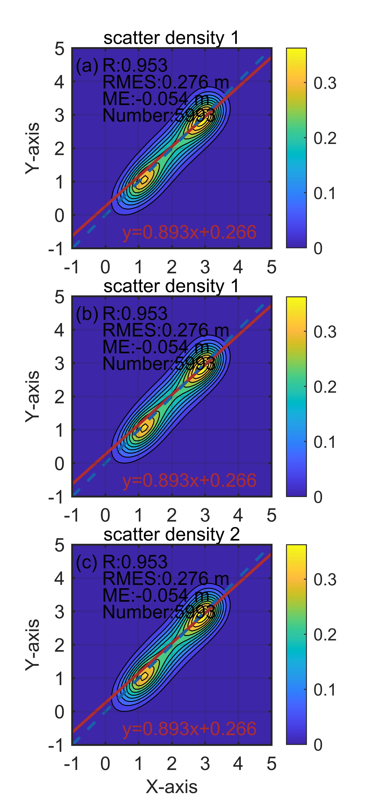
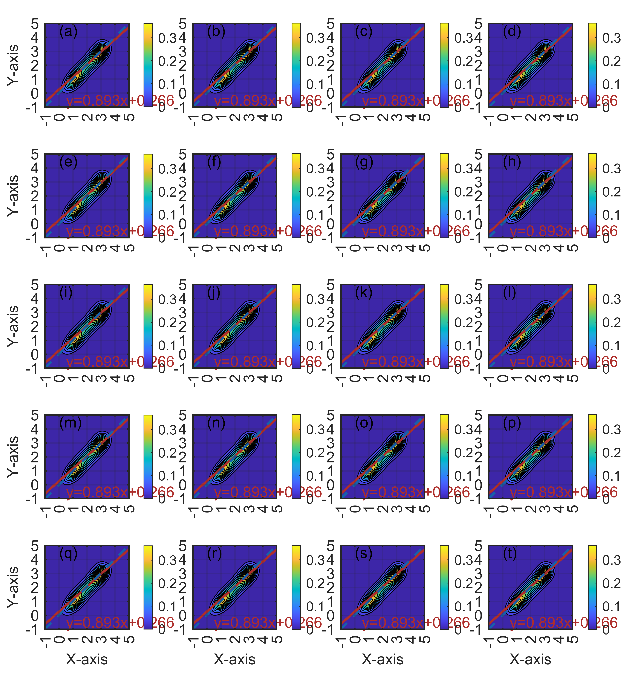

# MATLAB | Research Plotting Volume 19: Density Scatterplot Enhanced Edition

The drawing tutorial and color data link are included at the end of this message.
1. The completion of the drawing work that took a day's effort finally fulfilled the promise I made at the time, to create 1x1, 2x1, 1x2, 2x2, 2x3, 3x1, 1x3, and 5x4 figure sizes for tutorial drawings. This also allows me to use code for retrieval and application in the future, where only the x and y axis data need to be replaced to generate the figures. See for yourself~
As shown in the figure below, there are three sub-functions involved.
Here is an explanation of why figureWidth was set to 8.5: In dual-column layout, the space available for inserting the figure is limited.
How is it calculated? A4 paper specifications: 210mm×297mm. A4 paper is defined by the International Organization for Standardization (ISO) 216, with specifications of 210mm×297mm, which is the international standard used by most countries worldwide.
The requirements for paper margins on academic papers are: Top (T): 25 mm; Bottom (B): 25 mm; Left (L): 20 mm; Right (R): 20 mm.
This means that academic papers must be printed using A4 (210mm×297mm) standard white paper, leaving ample blank edges around the sides for binding, copying, and annotation purposes. Each side should have top (top border) and bottom (bottom border) margins of 25mm, left (left margin) and right (right margin) margins of 20mm. This is relative to general journal submissions.
Therefore, 210mm - 20mm - 20mm = 170mm, in a dual-column layout, the space left for placing images in a single column is only 85mm, or 8.5cm. Only then can the figures be imported into Word without changing their font size. If the figure size is 10cm, after being imported into Word, it will be compressed to 8.5cm, which means the font size of 10 in the figure will be compressed as well, no longer being the original 10-point font size. This explains why some SCIs have varying font sizes within each figure.

## Images

<!-- PAYMENT_BLOCK -->

## Get this dataset

- Payment link (Stripe): [Buy now](https://buy.stripe.com/3cs8yP7sY87d0vu9AB)
- Payment QR code: 

<!-- /PAYMENT_BLOCK -->
